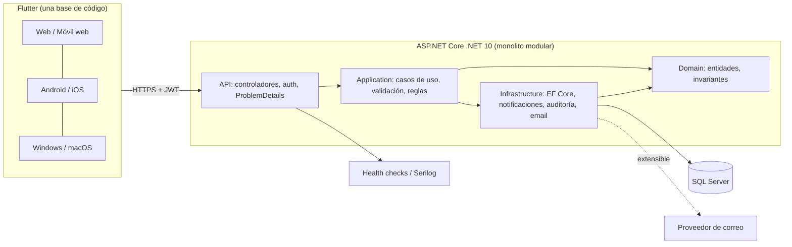
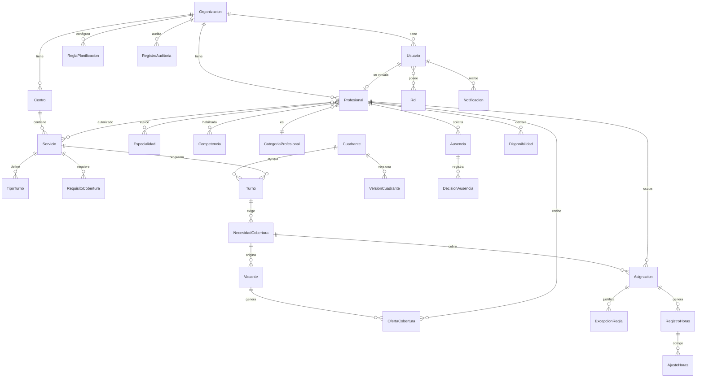

# MedicalHub — Fase 1: Análisis

## 1. Estado del proyecto

| Elemento | Estado |
|---|---|
| Repositorio | Git inicializado en `main`, **sin commits ni archivos**. Nada que reutilizar ni sobrescribir. |
| .NET | SDK 10.0.300 instalado (runtimes ASP.NET 8 y 10). Cumple .NET 10 LTS. |
| Flutter | 3.44.2 stable. Cumple. |
| SQL Server | Instancia `localhost` no accesible. **LocalDB `(localdb)\MSSQLLocalDB` responde** → válido para desarrollo. |
| Docker | No instalado. SQL Server de pruebas de integración: LocalDB o Testcontainers requeriría Docker (pendiente de decidir, ver §9). |
| Node 22, Git 2.54, sqlcmd 15 | Disponibles. |

Conclusión: proyecto desde cero (greenfield).

## 2. Requisitos funcionales (resumen priorizado)

Prioridad: **P0** = necesario para el escenario de aceptación del piloto; **P1** = MVP completo; **P2** = preparar arquitectura.

| Mód. | Contenido | Prio |
|---|---|---|
| Transversal | Multiempresa, autenticación, roles, auditoría | P0 |
| B Profesionales | CRUD, especialidades, categoría, competencias, centros/servicios autorizados, historial | P0 |
| C Centros y servicios | Centros, servicios, tipos de turno propios, requisitos de cobertura, responsable | P0 |
| D Turnos y cuadrantes | Calendario día/semana/mes + agenda móvil, turnos nocturnos, borrador/validar/publicar, versiones, plantillas, CSV | P0 |
| F Ausencias | Solicitud, aprobación/rechazo, turnos comprometidos, vacantes, historial (sin datos médicos) | P0 |
| G Cobertura y sustituciones | Candidatos, ofertas, aceptar/rechazar, aprobación, asignación transaccional y concurrente | P0 |
| H Validación | Motor de reglas configurable, bloqueantes vs. advertencias, excepciones justificadas | P0 |
| K Notificaciones | In-app (enviada ≠ leída), idempotencia, abstracción de email | P0 in-app / P2 email |
| A Dashboard | Por rol, datos de API | P1 |
| E Disponibilidad | Declarada / aprobada / asignación / ausencia; preferencias vs. bloqueos | P1 |
| I Control horario | Planificadas vs. registradas, nocturnas, ajustes con motivo | P1 |
| J Informes | Por profesional/centro/servicio/periodo, CSV; Excel/PDF extensibles | P1 / P2 |
| Plataforma | Alta de organizaciones, acceso auditado a datos de clientes | P1 |

### Escenario de aceptación (hilo conductor)
Coordinador publica semana → profesional solicita ausencia → coordinador aprueba → sistema detecta vacante → candidatos compatibles → oferta → profesional acepta → coordinador aprueba → cuadrante actualizado + notificaciones + historial. Más: aislamiento entre sociedades, excepciones, turnos nocturnos, informes desde backend, web+móvil, instalación documentada.

## 3. Requisitos no funcionales

- **Seguridad**: JWT de acceso corto + refresh token rotatorio con revocación; hash de contraseñas (PBKDF2/Argon2 vía `PasswordHasher`); límite de intentos y bloqueo temporal; MFA (TOTP) obligatorio para Admin de plataforma/sociedad y coordinador (recomendado; ver §9); HTTPS+HSTS; CORS restringido; cabeceras de seguridad; secretos solo por variables de entorno / user-secrets.
- **Aislamiento multiempresa**: `OrganizacionId` en toda entidad operativa; filtro global de EF Core por organización del token; el `OrganizacionId` nunca se acepta del cliente; pruebas automáticas cruzadas. Defensa en profundidad opcional: SQL Server Row-Level Security (P2).
- **Privacidad**: minimización de datos, sin datos clínicos, ausencias sin motivo médico (solo tipo), retención y borrado configurables, exportaciones protegidas y auditadas, documentación RGPD/LOPDGDD (registro de actividades, encargado de tratamiento, EIPD orientativa).
- **Concurrencia/consistencia**: `rowversion` + restricciones únicas + transacciones; aceptación de oferta atómica (`UPDATE … WHERE Estado = 'Abierta'`) para impedir doble asignación.
- **Observabilidad**: Serilog estructurado, correlation id, health checks (`/health/live`, `/health/ready`), OpenAPI.
- **Mantenibilidad**: monolito modular por capas (API / Application / Domain / Infrastructure), sin MediatR, **controladores (no Minimal API)**, nombres de dominio en español.
- **Fechas**: instantes en UTC en BD; zona IANA por organización y centro; turnos nocturnos modelados con inicio/fin en instante UTC (el "día de planificación" es el día local de inicio).
- **Rendimiento orientativo**: cuadrante mensual de 1 000 turnos < 1 s; paginación en listados.
- **UX**: Flutter MD3, es-ES, `dd/MM/yyyy`, 24 h, responsive (compacto < 600, medio < 840, expandido ≥ 840), accesibilidad básica.
- **Calidad**: pruebas unitarias de dominio, integración (API + SQL Server), aislamiento, flujos de asignación/sustitución, pruebas de widgets/golden por tamaño de pantalla.

## 4. Modelo de dominio

### Distinción central: Turno ≠ Necesidad de cobertura ≠ Asignación
- **Turno**: hecho planificado (servicio, tipo, inicio, fin). Puede existir vacío.
- **NecesidadCobertura**: qué hace falta para un turno (n profesionales, categoría, competencias). Un turno puede tener varias necesidades (p. ej. 1 anestesista senior + 1 enfermero).
- **Asignación**: profesional concreto ocupando una plaza de una necesidad. Estados: `Propuesta`, `PendienteAprobacion`, `Confirmada`, `Cancelada`.

### Agregados y entidades
- **Organizacion** (zona horaria, configuración, reglas activas).
- **Identidad**: `Usuario`, `Rol`, `UsuarioRol`, `UsuarioCentro` (alcance de responsables de centro), `RefreshToken`, `MfaSecreto`.
- **Catálogo**: `Especialidad`, `CategoriaProfesional`, `Competencia`.
- **Estructura**: `Centro` (zona IANA), `Servicio`, `TipoTurno` (por servicio), `Plantilla`/`PlantillaTurno`.
- **Profesional**: `Profesional` (1:1 opcional con Usuario), `ProfesionalEspecialidad`, `ProfesionalCompetencia` (con vigencia/caducidad), `ProfesionalServicio` (autorización).
- **Planificación**: `Cuadrante` (periodo + estado `Borrador/Publicado/Archivado`, versionado) → `Turno` → `NecesidadCobertura` → `Asignacion`; `VersionCuadrante` (instantánea).
- **Disponibilidad**: `Disponibilidad` (declarada/bloqueo/preferencia con peso), `Ausencia` (tipo, estado, decisión), `DecisionAusencia`.
- **Cobertura**: `Vacante` (derivada de necesidad sin cubrir), `OfertaCobertura` (por candidato), `SolicitudSustitucion`, `CambioTurno`.
- **Reglas**: `ReglaPlanificacion` (tipo, parámetros JSON, severidad Bloqueante/Advertencia, ámbito organización/servicio), `ExcepcionRegla` (justificación, autorizador).
- **Horas**: `RegistroHoras` (planificada/registrada), `AjusteHoras` (motivo, usuario), `CategoriaHoraria` (nocturna, festivo… configurable).
- **Transversal**: `Notificacion` (estado Enviada/Leída separados, clave de idempotencia única), `EventoOutbox`, `RegistroAuditoria`, `EventoSeguridad`.

### Invariantes clave
1. Una asignación activa por (necesidad, plaza) — índice único filtrado.
2. Un profesional no tiene asignaciones confirmadas solapadas (validado en servicio + comprobación transaccional con bloqueo por profesional).
3. `Fin > Inicio`; duración máxima configurable; los turnos nocturnos cruzan medianoche sin duplicarse.
4. Una oferta aceptada solo es válida si la plaza sigue abierta; las demás ofertas se cierran.
5. Solo se publica un cuadrante sin errores bloqueantes o con excepciones autorizadas.
6. Toda entidad operativa pertenece a una única organización; las referencias cruzadas se validan en la misma organización.

### Extensibilidad por especialidad
Las especialidades son datos (catálogo + competencias + tipos de turno + reglas), no código. El motor de reglas es una colección de implementaciones `IReglaPlanificacion` registradas por tipo y parametrizadas por JSON.

## 5. Arquitectura



### Estructura de repositorio propuesta
```
medicalhub/
  docs/                      # análisis, ADR, RGPD, backup/restore
  backend/
    MedicalHub.sln
    src/ MedicalHub.Api | .Application | .Domain | .Infrastructure
    tests/ MedicalHub.Domain.Tests | .Api.IntegrationTests
    scripts/ seed-demo.sql, backup/restore
  app/                       # Flutter
    lib/core (api, auth, router, tema, errores)
    lib/shared (widgets reutilizables)
    lib/features/<funcionalidad>/{presentation,application,data}
  deploy/                    # config hosting estático, ejemplos de env
```

Flutter: Riverpod (estado), go_router (navegación con guardas por rol), Dio (interceptores: token, refresh, errores), modelos con `json_serializable`/`freezed`; almacenamiento seguro del token (`flutter_secure_storage`; en web, memoria + cookie/almacenamiento con las salvedades de §9).

## 6. Diagrama entidad-relación (núcleo)



## 7. Decisiones técnicas

| # | Decisión | Motivo |
|---|---|---|
| D1 | Monolito modular, 4 proyectos por capas, sin MediatR | Requisito; simplicidad. Casos de uso como clases de servicio por funcionalidad. |
| D2 | Controladores MVC (no Minimal API) | Requisito explícito. |
| D3 | EF Core + SQL Server, migraciones versionadas, `rowversion` | Concurrencia optimista y reproducibilidad. |
| D4 | Multiempresa por columna `OrganizacionId` + filtro global EF | Escala a muchos clientes sin cambiar código; esquema único. |
| D5 | Autenticación JWT propia (ASP.NET Core Identity solo para hashing/lockout) | Sin licencias ni dependencias externas; control de refresh y MFA TOTP. |
| D6 | Validación con FluentValidation (Apache-2.0) o validación propia en Application | FluentValidation 12 es gratuito; alternativa: validadores propios. A confirmar. |
| D7 | Instantes UTC + zona IANA por centro | Evita errores con DST y turnos nocturnos (p. ej. 26–27 oct 2026 en España). |
| D8 | Notificaciones con patrón Outbox + clave de idempotencia | Reintentos sin duplicados; email conectable después. |
| D9 | Motor de reglas por estrategia (`IReglaPlanificacion`) con parámetros JSON | Configurable por organización; sin límites legales codificados. |
| D10 | Auditoría mediante interceptor de `SaveChanges` + eventos de negocio explícitos | Cobertura uniforme de cambios operativos. |
| D11 | Flutter: Riverpod + go_router + Dio + freezed/json_serializable | Requisito. |
| D12 | Pruebas de integración con SQL Server real (LocalDB / contenedor en CI) | SQLite/InMemory ocultan diferencias (rowversion, índices filtrados). |
| D13 | Serilog, OpenAPI nativo de .NET 10 (`Microsoft.AspNetCore.OpenApi`) | Estándar, gratuito. |

Librerías evitadas por licencia: MediatR, AutoMapper, FluentAssertions ≥ 8 (usar xUnit + Shouldly o aserciones nativas), componentes de calendario comerciales (Syncfusion). El calendario Flutter se construye con widgets propios.

## 8. Riesgos

| Riesgo | Impacto | Mitigación |
|---|---|---|
| Alcance muy amplio para un MVP | Alto | Entregas verticales guiadas por el escenario piloto; P1/P2 después. |
| Fuga entre organizaciones | Crítico | Filtro global + pruebas de aislamiento en cada endpoint + revisión de consultas `IgnoreQueryFilters`. |
| Doble asignación por concurrencia | Alto | Transacción + restricción única + prueba concurrente. |
| Turnos nocturnos / cambio horario | Medio | UTC + pruebas en fechas DST. |
| Reglas laborales heterogéneas | Alto | Reglas parametrizables; sin valores legales por defecto no revisados. |
| Calendario complejo en Flutter | Medio | Vista agenda como primera implementación en móvil. |
| Tokens en Flutter Web | Medio | Access token en memoria + refresh en cookie `HttpOnly`/`SameSite` en web; revisar CORS/CSRF. |
| Cumplimiento RGPD | Alto | Documentación y revisión por DPO/asesor legal; no sustituye asesoramiento jurídico. |
| Entorno sin Docker/SQL Server completo | Bajo | LocalDB para desarrollo; documentar Docker para CI/producción. |
| Compilación macOS/iOS desde Windows imposible | Bajo | Se validan Windows/Android/Web aquí; iOS/macOS requieren máquina Mac. |

## 9. Preguntas pendientes

1. **Roles del profesional**: ¿un mismo usuario puede ser profesional y coordinador a la vez? (Propongo roles múltiples por usuario.)
2. **Planes de turno**: ¿las guardias son de 24 h con relevo a una hora fija (p. ej. 08:00) o cada servicio define sus franjas libremente? (Propongo libre por `TipoTurno`.)
3. **Aprobación de sustituciones**: ¿siempre requiere aprobación del coordinador o configurable por servicio? (Propongo configurable, por defecto sí.)
4. **MFA**: ¿obligatorio para administradores y coordinadores en el MVP (TOTP)? (Recomendado: sí, activable por organización.)
5. **Email**: ¿proveedor previsto (SMTP, Graph, SendGrid)? En el MVP solo se deja la interfaz.
6. **Hosting objetivo**: ¿Azure, IIS on-premise u otro? Condiciona la guía de despliegue.
7. **Base de pruebas**: ¿aceptas LocalDB para desarrollo/pruebas, o hay un SQL Server accesible?
8. **Validación**: ¿FluentValidation (gratuito) o validadores propios?
9. **Nombres en español**: ¿también en el código C# y API (`/api/profesionales`, clases `Profesional`), con las claves de JSON en español? (Propuesto: sí, identificadores sin tildes ni ñ.)
10. **Idiomas futuros**: ¿solo es-ES (con arb de Flutter preparado) o también catalán/gallego/euskera?
11. **Datos personales de profesionales**: ¿nº de colegiado, DNI? (Propuesto: nombre, nº colegiado opcional, correo y teléfono; sin DNI.)

## 10. Plan de implementación por entregas

| Entrega | Contenido | Resultado demostrable |
|---|---|---|
| **E0** Cimientos | Solución .NET, proyecto Flutter, CI local, Serilog, health checks, OpenAPI, EF + primera migración, estructura de tests | API arranca, `/health` OK, app Flutter muestra pantalla de inicio |
| **E1** Identidad y multiempresa | Organizaciones, usuarios, roles, login/refresh/logout, bloqueo por intentos, MFA, filtro de organización, auditoría base, pruebas de aislamiento | Login por rol y protección cruzada probada |
| **E2** Catálogos, centros, servicios, profesionales | Módulos B y C completos + seed demo | CRUD funcional en Flutter |
| **E3** Planificación | Cuadrantes, turnos, necesidades, asignaciones, calendario (día/semana/mes/agenda), plantillas, versiones, CSV | Cuadrante semanal creado en web y móvil |
| **E4** Motor de reglas | Reglas base, severidades, excepciones, validación y publicación | Publicación bloqueada/permitida con excepción |
| **E5** Ausencias y disponibilidad | Módulos E y F, detección de vacantes | Ausencia → vacante |
| **E6** Cobertura y sustituciones | Módulo G con concurrencia, notificaciones in-app (K) | **Escenario piloto completo** |
| **E7** Dashboard, horas e informes | Módulos A, I, J | Informes desde backend |
| **E8** Endurecimiento y despliegue | Pruebas de pantalla, seguridad, backup/restore probado, documentación RGPD, publicación Flutter Web, guía de instalación | Instalación reproducible |

Cada entrega termina con pruebas verdes y presentación de resultados antes de continuar.
